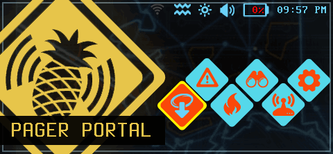

# WiFi Pineapple Pager — Viewer (display del firmware REAL)

App web que muestra el **display del firmware real** (que corre bajo qemu y
expone su *Virtual Pager* por WebSocket) dentro de la carcasa amarilla del Pager,
con botones tactiles que **navegan el firmware**.

Abri la app -> ves el framebuffer real (480x222) del firmware en la pantalla, y
con los botones (D-pad / SELECT / BACK) o el teclado fisico navegas el firmware.



> *(La imagen de arriba es un frame REAL capturado por este viewer a traves de
> `proxy.py` contra el firmware en el G82: la home "PAGER PORTAL".)*

## Archivos

- `index.html` — la carcasa amarilla (reusa estetica/estructura de
  `../../frontend/`): `#stage > #pager > #screen-bezel > #screen > canvas#display`,
  `#buttons` con los `.hwbtn[data-key]` del D-pad/flechas/SELECT/BACK, LEDs, brand.
  El `#display` es un `<canvas 480x222>` donde se pinta el stream del firmware.
- `app.js` — login + cookie, `screen.ws` (frames RGBA -> `putImageData`),
  `keys.ws` (teclas en texto plano), LED flash + buzzer (Web Audio), `fitPager`
  (escalado + landscape, reusado de `../../frontend/boot.js`).
- `style.css` — carcasa amarilla / botones / overlay (adaptado de
  `../../frontend/style.css`; se quito todo el CSS de la UI recreada porque aqui
  el display lo dibuja el propio firmware dentro del canvas).
- `proxy.py` — **proxy same-origin opcional** que resuelve CORS/cookies (ver abajo).

## Como se conecta (protocolo, RE confirmado)

Ver tambien `../VIRTUAL_PAGER_REPORT.md`.

1. **Login** — `POST {BASE}/api/login {"username":"root","password":PW}` ->
   `{"token": "<b64url(json).b64sig>"}`.
   `ServerId = JSON(base64url(token.split('.')[0])).ServerId`.
   cookie `AUTH_<ServerId>=<token>` (path=/, 12h). `GET /api/api_ping` valida.
   Password root por defecto: `pineapplepager` (configurable en `DEFAULT_PASSWORD`
   de `app.js`; si el login falla, la app muestra un prompt de password).
2. **Screen (visor)** — `ws {WSBASE}/api/pager/display/screen.ws` (cookie AUTH).
   Frames **binarios** RGBA raw (Go `image.RGBA` Pix), 480x222x4 = **426240 bytes**.
   `app.js` copia el `ArrayBuffer` a un `ImageData` y hace `putImageData` al canvas.
3. **Input** — `ws {WSBASE}/api/pager/input/keys.ws` (cookie AUTH).
   Se manda **texto plano** = `KeyboardEvent.key`:
   `ArrowUp`/`ArrowDown`/`ArrowLeft`/`ArrowRight`, `Enter` (=boton A / SELECT),
   `Escape` (=boton B / BACK). Mapeo de botones de la carcasa en `KEY_LED`.

## CORS / cookies — el punto clave

El navegador **NO permite setear headers (ni, cross-site, la cookie) en el
handshake de un WebSocket**. Para que `screen.ws`/`keys.ws` lleven la cookie
`AUTH_<sid>`, esta tiene que ser una cookie **real del navegador** que se mande
automaticamente, y eso solo pasa si el WS es del **MISMO ORIGEN** que la cookie.

Por eso hay dos modos:

### MODO A — same-origin (recomendado) — usar `proxy.py`

`proxy.py` sirve la app estatica **y** hace de puente al firmware en el mismo
origen: todo lo que empieza con `/api/*` (HTTP y los dos WebSockets) se reenvia a
`:1471`. El navegador habla SIEMPRE con el proxy (un solo origen), asi:
- el `fetch` de login setea `AUTH_<sid>` same-origin,
- los WS `screen.ws`/`keys.ws` mandan esa cookie solos,
- el proxy copia la cookie hacia el firmware en el handshake. **Cero CORS.**

```sh
pip install websockets           # requerido para el puente WebSocket
cd qemu-firmware/viewer
python3 proxy.py --firmware 127.0.0.1:1471 --listen 0.0.0.0:8471
# abri:  http://<IP-del-host>:8471/     (sin ?host= -> same-origin = el proxy)
```

En el G82, con el firmware en `127.0.0.1:1471`:
```sh
python3 proxy.py --firmware 127.0.0.1:1471 --listen 0.0.0.0:8471
# desde la laptop:  http://192.168.1.53:8471/
```

### MODO B — servir estatico sin proxy

Solo funciona bien si la app se sirve **desde el mismo origen que el firmware**
(p.ej. embebida en el propio :1471). En ese caso `app.js` usa `BASE=''`
(same-origin) y todo anda sin proxy.

Servir desde **otro** origen (p.ej. `python -m http.server 8000` apuntando con
`?host=IP:1471`) **no es fiable desde el navegador**: el fetch de login choca con
CORS/SameSite y el WS cross-site no manda la cookie. Para ese caso: usar `proxy.py`.

### Config del host

- Sin `?host=` -> same-origin (usar con `proxy.py` o embebido). **Default.**
- `?host=127.0.0.1:1471` -> apunta directo (solo si ese origen coincide con el
  de la pagina; si no, ver MODO B).
- Constante `DEFAULT_HOST` en `app.js` para fijar un host por defecto.

## Como probarlo

### Rapido (con proxy, mismo host que el firmware)
```sh
cd qemu-firmware/viewer
python3 proxy.py --firmware 127.0.0.1:1471 --listen 0.0.0.0:8471
# navegador -> http://127.0.0.1:8471/  (o la IP del host)
# deberias ver la home "PAGER PORTAL" y poder navegar con los botones
```

### Validacion
- `node --check app.js` — sintaxis OK.
- `python3 -m py_compile proxy.py` — compila OK.

## Que se valido (honesto)

Todo esto se corrio y PASO **contra el firmware REAL en el G82** (qemu-mipsel,
`:1471`, password root `pineapplepager`), via `proxy.py`:

- `node --check app.js` ✅ y `py_compile proxy.py` ✅.
- Suite e2e con un mock del firmware (HTTP+WS en un puerto) -> ALL PASS: estatico,
  login forward, api_ping con/sin cookie, screen.ws (426240 bytes), keys.ws.
- **e2e real** (`proxy.py` -> firmware `127.0.0.1:1471`, cliente WS estilo
  navegador con frames enmascarados): **ALL PASS**
  - static `index.html`/`style.css` servidos por el proxy,
  - `POST /api/login` via proxy -> `ServerId`,
  - `GET /api/api_ping` + cookie via proxy -> 200,
  - `screen.ws` via proxy -> frame real **426240 bytes**,
  - `keys.ws` via proxy -> `ArrowDown` -> el display **cambio 64.35%**
    (el firmware navego).
  - Frame capturado a traves del proxy y decodificado igual que `app.js`
    (`frombytes RGBA 480x222` == `putImageData`): se ve la home real
    "PAGER PORTAL" (ver `viewer_proxy_frame.png`).

Lo que **no** validé al 100%: el render dentro de un navegador real headless
(no habia uno disponible en este entorno). El canvas/`putImageData` usa el MISMO
decode byte-a-byte que el PNG capturado (que si verifiqué visualmente), y la
logica de botones/teclado reusa la del frontend ya existente; pero el pixel final
en pantalla depende del navegador. El camino de datos (login/cookie/screen/keys/
CORS) está probado e2e contra el firmware real.
